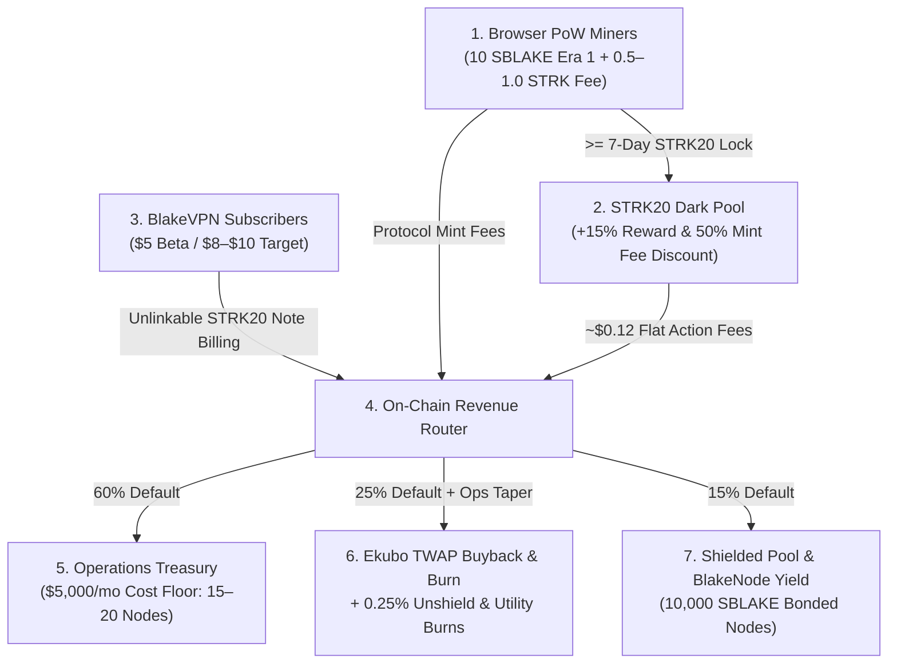

<div align="center">

# ⚡ STARKBLAKE (`SBLAKE`) — BlakeVPN & BlakeNode

### Privacy-First Browser PoW Miner, STRK20 Dark Pool & Unlinkable DePIN dVPN on Starknet  
**Aligned with BlakeVPN & BlakeNode Economic & Operational Documentation (Draft 1.1, October 2026)**

[-blue?logo=starknet&style=for-the-badge)](https://starknet.io)
[](https://book.cairo-lang.org)
[-00f3ff?style=for-the-badge)](https://starknet.io)
[](#technical-specifications)
[](#-invited-beta-roadmap--validation-gates)
[](LICENSE)

[Live App](http://localhost:3000) • [Draft 1.1 Status Report](./progress.md) • [Economic Simulator](#-economic-flywheel--revenue-routing-draft-11) • [1-Click Deploy](#-1-click-contract-deployment-xverse--argent--braavos)

</div>

---

## 🌌 Vision & Beta-First Strategy

**StarkBlake (`SBLAKE`)** powers **BlakeVPN** and **BlakeNode**—a privacy-first, decentralized VPN and residential relay network built on Starknet using the **STRK20 (SNIP-36)** confidential token framework.

* **Phone & Browser PoW Mining**: Multi-threaded Web Worker BLAKE2s mining accessible from any desktop or mobile browser without specialized ASICs.
* **Unlinkable BlakeVPN Billing**: Users purchase VPN bandwidth passes (`$5/mo` Invited Beta minimum; `$8–$10/mo` Post-Beta target) by spending encrypted **STRK20 notes** (`nullifiers`) so their public wallet identity is mathematically unlinked from their VPN session public key.
* **BlakeNode DePIN Collateral**: Exit and residential relay node operators bond **`10,000 SBLAKE`** per node (with temporary collateral subsidies available during the Invited Beta) to earn real protocol revenue yield.
* **Sustainable Revenue-Backed Flywheel**: Protocol revenue from Mint Fees (`0.5–1.0 STRK`), BlakeVPN subscriptions, and STRK20 privacy actions is routed **`60%` Operations Treasury / `25%` Ekubo TWAP Buyback & Burn / `15%` Shielded & Node Yield**, securing the **`$5,000/mo` Operations Cost Floor** before tapering into accelerated token burns.
* **Beta-First Validation Policy**: Public token presales are **deferred** until the **3–4 Month Invited Beta** validates `15–25` BlakeNodes ($\ge 95\%$ uptime) and `40–80` VPN client testers ($\ge 40\%$ 30-day retention).

---

## 💎 Tokenomics & Emission Schedule (Draft 1.1)

* **Token Symbol**: `SBLAKE`
* **Max Supply Cap**: `21,000,000 SBLAKE` (Hard-capped)
* **Year-1 Emission Target**: `6,000,000 – 9,000,000 SBLAKE` gross emitted, with **Net Circulating Free Float kept $\le 40\text{–}45\%$** via 7-day STRK20 dark pool locks, `10,000 SBLAKE` BlakeNode bonds, and TWAP buyback + utility burns.

### Halving Schedule (Cadence: Every `900,000` Mints / `~10–14 Months` at 400–600 Miners)

| Era | Base Mint Reward | STRK20 Shielded Reward (+15%) | Mint Interval | Gross Era Emission | Status |
| :---: | :---: | :---: | :---: | :---: | :---: |
| **Era 1** | **10 SBLAKE** | **11.5 SBLAKE** | `0 – 900,000` | `~9,000,000 SBLAKE` | 🟢 **ACTIVE (BETA)** |
| **Era 2** | **5 SBLAKE** | **5.75 SBLAKE** | `900,001 – 1,800,000` | `~4,500,000 SBLAKE` | ⏳ Upcoming |
| **Era 3** | **2.5 SBLAKE** | **2.875 SBLAKE** | `1,800,001 – 2,700,000` | `~2,250,000 SBLAKE` | ⏳ Upcoming |
| **Era 4** | **1.25 SBLAKE** | **1.4375 SBLAKE** | `2,700,001 – 3,600,000` | `~1,125,000 SBLAKE` | ⏳ Upcoming |
| **Era 5** | **0.625 SBLAKE** | **0.71875 SBLAKE** | `3,600,001 – 4,500,000` | `~562,500 SBLAKE` | ⏳ Upcoming |
| **Era 6+** | **0.3125 SBLAKE** | **0.359375 SBLAKE** | `4,500,001+` | Tail until `21M` cap | ⏳ Upcoming |

---

## 🔄 Economic Flywheel & Revenue Routing (Draft 1.1)



### 1. Three Real Protocol Revenue Streams
1. **Protocol Mint Fee (`0.5–1.0 STRK`)**: Paid per valid PoW mint. Miners who keep their rewards shielded in the STRK20 pool for **$\ge 7$ days (`604,800` seconds)** unlock a **50% Mint Fee Discount** plus the **+15% shielded reward boost**.
2. **BlakeVPN Subscriptions (`$5/mo` Beta $\rightarrow$ `$8–$10/mo` Target)**: Paid directly in `SBLAKE` (via unlinkable STRK20 notes or public balance) or in `STRK`/`USDC` auto-swapped via Ekubo.
3. **STRK20 Privacy Action Fees (`~$0.10–$0.15` Flat)**: Collected on shield, unshield, and private note transfers, alongside a **0.25% deflationary burn** on unshielding.

### 2. Revenue Split & `$5,000/mo` Operations Floor Taper Rule
| Allocation Bucket | Year-1 Default | Operational Purpose & Governance Rule |
| :--- | :---: | :--- |
| **Operations Treasury** | **60%** *(50–70%)* | Funds the **`$5,000/mo` Ops Cost Floor**: `$3,000–$4,000/mo` for 15–20 multi-region EU/US/Asia exit nodes, `$1,000–$1,500/mo` lean community growth, and `$500–$1,000/mo` RPC/security contingency. **Automatically tapers down** once the `$5,000/mo` floor is covered for 3 consecutive months. |
| **Buyback & Burn** | **25%** *(20–30%)* | Executes automated Ekubo TWAP buybacks and permanent supply burns (`total_burned`). Absorbs excess allocation when the Operations share tapers. |
| **Shielded & Node Yield** | **15%** *(10–20%)* | Distributed to $\ge 7$-day STRK20 dark pool holders and verified BlakeNode operators meeting $\ge 95\%$ uptime SLAs. |

---

## 🛠️ 1-Click Contract Deployment (Xverse • Argent X • Braavos)

StarkBlake includes a **1-Click Sepolia Contract Deployer** (`src/components/ContractDeployer.tsx`) engineered for **Starknet RPC `v0_10`** and **`starknet.js v8.9.2`**:

* **Full Xverse Compatibility**: Consumer wallets like Xverse do not implement raw `wallet_addDeclareTransaction`. Our built-in automated Sepolia relayer handles class declaration with native V3 `l1_data_gas` resource bounds, and then deploys your contract instance via Starknet's canonical **Universal Deployer Contract (UDC)** (`0x041a78e741e5af2fec34b695679bc6891742439f7afb8484ecd7766661ad02bf`) using a standard `execute` call.
* **Upgradeable & Configurable On-Chain**: Supports `upgrade(new_class_hash)` via `replace_class_syscall`, `set_halving_interval`, `set_beta_config`, and `set_revenue_shares`.

### Current Compiled Artifacts (`contracts/src/sblake.cairo`)
* **Sierra Class Hash**: `0x1287c5cce2f2c41d3806c196ed87c58e0968e0cf0fd482b872621b54778e391`
* **CASM Class Hash**: `0x71a32f7e84351096cba593526d2be781d995b2d0406e0d29aecc2dbea234b94`
* **Sepolia Relayer Account**: `0x35260a1162058d98cda528a7e7484195fda550acc5db70a840e0b89339a1f07`

---

## 🚀 Quickstart Guide

### Prerequisites
* [Node.js](https://nodejs.org) (v18+)
* [Scarb](https://docs.swmansion.com/scarb/) (v2.8.0+ for Cairo contract compilation)
* **Xverse**, **Argent X**, or **Braavos** Wallet (Starknet Sepolia Testnet)

### 1. Install & Run Frontend
```bash
git clone https://github.com/fearmexxx/blake.git
cd blake
npm install
npm run dev
```
Open **`http://localhost:3000`** in your browser to access:
1. **Core Browser Miner** (`10 SBLAKE` Era 1 reward, `+15%` STRK20 Shielded Mode, multi-core worker selector).
2. **BlakeVPN & BlakeNode Invited Beta Console** (test unlinkable `250 SBLAKE` VPN pass billing and subsidized BlakeNode registration).
3. **1-Click Sepolia Contract Deployer** (with live class upgrade & halving timeline governance).
4. **Draft 1.1 Economic Flywheel Simulator** (interactive stress-testing across *Invited Beta*, *Post-Beta Target*, and *Growth Scale* presets).

### 2. Compile Cairo Smart Contract
```bash
cd contracts
scarb build
```

### 3. Production Build Verification
```bash
npm run build
```

---

## 📜 Cairo Smart Contract Interface (`ISBlakePrivacy`)

```rust
#[starknet::interface]
pub trait ISBlakePrivacy<TState> {
    // Core PoW & STRK20 Shielded Mining (Draft 1.1: 10 SBLAKE Era 1, 900k Halving Interval)
    fn get_challenge(self: @TState, user: ContractAddress) -> (u64, u256, u256, u32);
    fn mint(ref self: TState, nonce: u256, brother_id: felt252);
    fn mint_shielded(ref self: TState, nonce: u256, commitment: felt252, encrypted_note: Span<felt252>);

    // STRK20 Privacy Pool & 7-Day Maturity Tracking
    fn shield(ref self: TState, amount: u256, commitment: felt252);
    fn unshield(ref self: TState, nullifier: felt252, recipient: ContractAddress, amount: u256);
    fn is_commitment_matured(self: @TState, commitment: felt252) -> bool;

    // BlakeNode Collateral Bonding (10,000 SBLAKE or Invited Beta Subsidy)
    fn bond_blake_node(ref self: TState, region: felt252, subsidized: bool);
    fn unbond_blake_node(ref self: TState);

    // Unlinkable BlakeVPN Subscription Pass & Utility Burn Sinks (60/25/15 Split)
    fn purchase_vpn_pass(ref self: TState, amount: u256, session_pubkey: felt252, nullifier: felt252);
    fn burn_for_utility(ref self: TState, amount: u256, utility_type: felt252);

    // Governance, Beta Gate Controls & Upgradeability
    fn upgrade(ref self: TState, new_class_hash: ClassHash);
    fn set_halving_interval(ref self: TState, new_interval: u64);
    fn set_beta_config(ref self: TState, is_beta: bool, mint_fee: u256, strk20_fee: u256, vpn_min_price: u256);
    fn set_revenue_shares(ref self: TState, ops_bps: u16, burn_bps: u16, yield_bps: u16);
    fn get_protocol_metrics(self: @TState) -> (u256, u256, u64, u64, u256, u256, bool);
}
```

---

## 🗺️ Invited Beta Roadmap & Validation Gates

- [x] **Phase 0 — Core Engine & STRK20 Architecture**: Multi-threaded Web Worker BLAKE2s miner, hardware anti-Sybil fingerprinting, STRK20 commitments & viewing keys.
- [x] **Phase 1.0 — Draft 1.1 Alignment & Xverse v0.10 Support**: `10 SBLAKE` Era 1 schedule (`900k` mints), 7-day STRK20 lock maturity, BlakeNode bonding, unlinkable VPN billing, `60/25/15` revenue router, and Starknet v8 UDC deployer.
- [ ] **Phase 1.1 — Invited Beta Cohort (Months 1–4)**:
  - Onboard **`15–25` Invited BlakeNode Operators** across EU, US, and Asia ($\ge 95\%$ uptime, $\le \$200/\text{mo}$ bandwidth cost per node).
  - Onboard **`40–80` Invited BlakeVPN Client Testers** ($\ge 40\%$ 30-day retention, $\ge 30\%$ verified willingness to pay `$5–$10/mo`).
- [ ] **Phase 2 — Post-Beta Decision Gate & Mainnet Launch**:
  - Evaluate 90-day Beta retention and `$5,000/mo` Ops Cost Floor coverage before deciding on a capped liquidity seed vs. direct Ekubo protocol-owned liquidity launch.

---

## 📄 License

This project is open-source and released under the **[MIT License](LICENSE)**.
