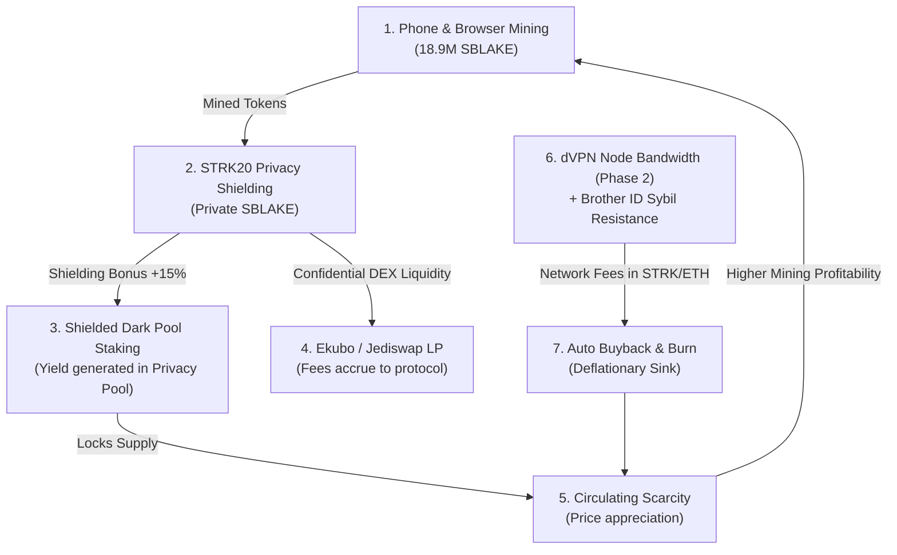

<div align="center">

# ⚡ STARKBLAKE (SBLAKE)

### Fair-Launch Browser & Mobile PoW Miner on Starknet  
**Native STRK20 Privacy Pool • Anti-Sybil Proof-of-Humanity • Deflationary Flywheel**

[](https://starknet.io)
[](https://book.cairo-lang.org)
[-00f3ff?style=for-the-badge)](https://starknet.io)
[](#technical-specifications)
[](LICENSE)

[Live App](http://localhost:3000) • [PRD Specification](./starkblake.md) • [Privacy Architecture](./privacy_and_economic_flywheel_plan.md) • [Deploy Contract](#-1-click-contract-deployment)

</div>

---

## 🌌 Vision & Manifesto

**StarkBlake (SBLAKE)** is designed to be the **fairest, most decentralized, and accessible Proof-of-Work token on Starknet**.

* **100% Fair Launch**: No VC pre-allocations, no team reserve tokens, no private seed rounds.
* **Phone & Browser First**: Anyone with a smartphone or browser can mine without specialized ASICs or expensive GPU rigs.
* **Protocol-Native Privacy**: Built on Starknet's **STRK20** confidential token standard (powered by SNIP-36 in-protocol STARK verifiers).
* **Anti-Sybil Proof-of-Humanity**: Multi-layer hardware fingerprinting combined with **Brother ID** bonus mechanics prevent GPU farm takeovers.

---

## 💎 Tokenomics & Emission Halving

* **Token Symbol**: `SBLAKE`
* **Total Supply**: `21,000,000 SBLAKE` (Hard-capped, Bitcoin-style)

```
┌─────────────────────────────────────────────────────────────┐
│ 90% Pure PoW Mining (18,900,000 SBLAKE)                     │
│ 5% Genesis Public Sale (1,050,000 SBLAKE @ ~$0.02)          │
│ 5% DEX Liquidity Pool Seed (1,050,000 SBLAKE - Locked)      │
└─────────────────────────────────────────────────────────────┘
```

### Halving Schedule (Cadence: Every 100,000 Mints)

| Era | Block Reward | Era Duration | Halving Trigger | Status |
| :---: | :---: | :---: | :---: | :---: |
| **Era 1** | **100 SBLAKE** *(115 Shielded)* | ~69 Days | Mints 0 – 100,000 | 🟢 **ACTIVE** |
| **Era 2** | **50 SBLAKE** *(57.5 Shielded)* | ~69 Days | Mints 100,001 – 200,000 | ⏳ Upcoming |
| **Era 3** | **25 SBLAKE** *(28.75 Shielded)* | ~69 Days | Mints 200,001 – 300,000 | ⏳ Upcoming |
| **Era 4** | **12.5 SBLAKE** *(14.37 Shielded)* | ~69 Days | Mints 300,001 – 400,000 | ⏳ Upcoming |

---

## 🔒 The STRK20 Privacy Framework & Economic Flywheel

Traditional fair-launch PoW tokens suffer from constant miner dump pressure. StarkBlake solves this by turning **confidentiality and utility into a supply sink**.



### 1. Shielded Minting Bonus (+15% Yield)
Miners can toggle between **Transparent Minting** and **STRK20 Shielded Minting**:
* Transparent minting awards the base **100 SBLAKE** to the miner's public wallet address.
* Shielded minting creates an on-chain encrypted note commitment:
  $$\text{Commitment} = \text{Poseidon}(\text{OwnerPubKey}, \text{Amount}, \text{Salt})$$
  and awards **115 SBLAKE** (+15% emission multiplier), incentivizing miners to lock circulating supply directly into the privacy pool.

### 2. Auditable Viewing Keys (SNIP-36 Compliance)
Miners derive client-side viewing keys:
$$\text{VK} = \text{SHA256}(\text{"SBLAKE\_STRK20\_VIEWING\_KEY\_V1"} \,\|\, \text{Wallet})$$
allowing users to export non-custodial audit trails for compliance without exposing their transaction history publicly.

### 3. Deflationary Burn Sink
A **0.25% fee** on unshielding transactions and protocol-captured DEX swap fees automatically feed an on-chain autonomous buyback and burn engine.

---

## 🛡️ Anti-Sybil Defense Architecture

To ensure tokens are minted by **real humans** using personal devices rather than cloud GPU farms, StarkBlake enforces a multi-tier defense:

1. **Hardware & Canvas Fingerprinting**: Client-side entropy gathered from Canvas 2D rasterization, WebGL unmasked GPU renderer/vendor data, hardware concurrency, screen dimensions, and color depth hashed via SHA-256.
2. **Rolling 24-Hour Daily Mint Cap**: Standard accounts are hard-capped at **10 mints per 24 hours** on-chain.
3. **Brother ID Bonus ($2\times$ Multiplier)**: Verified human identity holders receive a **20 mints per 24 hours** cap and lower unshielding fees.
4. **Challenge Freshness**: Challenges incorporate recent Starknet block hashes to prevent off-chain pre-computation.

---

## 🚀 Quickstart Guide

### Prerequisites
* [Node.js](https://nodejs.org) (v18+)
* [Scarb](https://docs.swmansion.com/scarb/) (v2.8.0+)
* [Argent X](https://www.argent.xyz/argent-x/) or [Braavos](https://braavos.app/) Wallet (configured for Sepolia testnet)

### 1. Installation
```bash
# Clone the repository
git clone https://github.com/fearmexxx/blake.git
cd blake

# Install dependencies
npm install
```

### 2. Start Development Miner
```bash
npm run dev
```
Open **`http://localhost:3000`** in your browser.

### 3. Build for Production
```bash
npm run build
```

---

## 🛠️ 1-Click Contract Deployment (Sepolia)

StarkBlake includes a **built-in 1-Click Web Deployer** embedded directly into the UI:

1. Launch the app (`http://localhost:3000`).
2. Click **CONNECT WALLET** and approve Argent X / Braavos on Sepolia.
3. Scroll to the **"SEPOLIA 1-CLICK CONTRACT DEPLOYER"** card (or click **DEPLOY CONTRACT** in the top navbar).
4. Click **`[ DEPLOY SBLAKE CONTRACT TO SEPOLIA ]`**.
5. Approve the declaration and deployment prompt in your wallet extension.
6. The app automatically captures the deployed address, links it on [Starkscan](https://sepolia.starkscan.co), and switches the miner into live on-chain mode!

---

## 📂 Project Architecture

```
starkmine/
├── contracts/                  # Cairo 2.8.0 Smart Contracts
│   ├── Scarb.toml             # Scarb package configuration
│   ├── src/
│   │   ├── lib.cairo          # Module entry point
│   │   └── sblake.cairo       # Core SBLAKE STRK20 Privacy & PoW contract
│   └── target/dev/            # Compiled Sierra & CASM artifacts
├── src/
│   ├── components/
│   │   ├── Miner.tsx          # Multi-core Dashboard & Telemetry UI
│   │   └── ContractDeployer.tsx # 1-Click Sepolia in-browser deployer
│   ├── utils/
│   │   ├── privacy.ts         # STRK20 Note Commitments & Viewing Keys
│   │   ├── starknet.ts        # Starknet.js v6 RPC provider & execution
│   │   └── fingerprint.ts     # Canvas/WebGL/Hardware anti-Sybil engine
│   ├── workers/
│   │   └── miner.worker.ts    # Parallel Web Worker BLAKE2s hashing engine
│   ├── App.tsx                # Main Application & Matrix theme
│   └── main.tsx               # React 18 root
├── starkblake.md              # Full Phase 1 Product Requirements Document
├── privacy_and_economic_flywheel_plan.md # STRK20 Privacy & Flywheel Specification
└── README.md                  # Project Homepage & Documentation
```

---

## 📜 Cairo Smart Contract Interface

```rust
#[starknet::interface]
pub trait ISBlakePrivacy<TState> {
    // Challenge & Mining Endpoints
    fn get_challenge(self: @TState, user: ContractAddress) -> (u64, u256, u256, u32);
    fn mint(ref self: TState, nonce: u256, brother_id: felt252);
    fn mint_shielded(ref self: TState, nonce: u256, commitment: felt252, encrypted_note: Span<felt252>);
    
    // STRK20 Privacy Pool Endpoints
    fn shield(ref self: TState, amount: u256, commitment: felt252);
    fn balance_of(self: @TState, account: ContractAddress) -> u256;
    fn total_supply(self: @TState) -> u256;
    fn get_shielded_supply(self: @TState) -> u256;
    fn get_shielded_commitments_count(self: @TState) -> u64;
    fn get_era_info(self: @TState) -> (u8, u256, u64);
}
```

---

## 🗺️ Roadmap

- [x] **Phase 1 MVP**: Matrix-industrial React frontend, multi-threaded Web Worker BLAKE2s miner, browser fingerprinting.
- [x] **STRK20 Privacy Upgrade**: Note commitment generation, viewing key derivation, and Cairo shielded pool implementation with +15% emission yield boost.
- [x] **1-Click Web Deployer**: Direct browser wallet deployment to Starknet Sepolia.
- [ ] **Phase 1.1**: Native on-chain Cairo BLAKE2s hash verifier and dynamic epoch difficulty retargeting.
- [ ] **Phase 1.2**: Genesis Public Sale (5% allocation) and automated Ekubo/Jediswap LP permanent liquidity lock (`seedPool`).
- [ ] **Phase 1.3**: Rust/WASM SIMD miner acceleration (targeting 1–5 MH/s per device).
- [ ] **Phase 2 Hybrid dVPN**: Run light dVPN nodes for +40% mining yield, VPN bandwidth fee auto-buyback and burn.

---

## 📄 License

This project is open-source and released under the **[MIT License](LICENSE)**.
