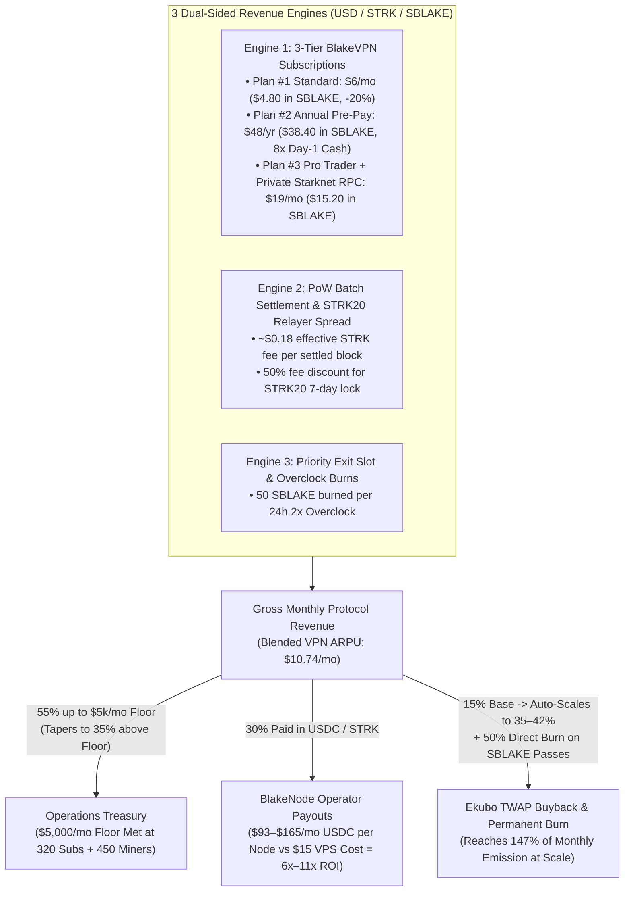

# StarkBlake (`SBLAKE`) & BlakeVPN — High-Velocity Economic Flywheel v2.1

## 1. Why We Upgraded from v2.0 to v2.1 (5× Faster Breakeven & Net-Deflationary Crossover)

In v2.0, relying on a single flat `$6.00/mo` plan with a static `55%` Ops share required **1,515 monthly recurring subscribers** just to hit the `$5,000/mo` Operations Cost Floor. For an early-stage Web3 DePIN launch, acquiring 1,515 paid VPN subscribers before reaching operational breakeven is too slow.

**v2.1 restructures the flywheel around 3 High-Margin Revenue Engines and 4 Coordinated Token Sinks**, cutting the breakeven threshold by **~5× (to just 320 VPN subscribers + 450 active miners)** and turning `SBLAKE` **net deflationary (`147%` of emission burned)** by Month 12:

---

## 2. v2.1 Multi-Tier Pricing Architecture (`VpnPayments` On-Chain Plans)

| Plan ID | Tier Name | USD Price (`pay_stable`) | `SBLAKE` Price (`pay_sblake`, `-20%`) | Target Segment & Strategic Purpose |
| :---: | :--- | :---: | :---: | :--- |
| **Plan `#1`** | **Standard Consumer Pass** (30d) | **$6.00 / mo** | **$4.80 / mo** (`50%` burned) | Everyday privacy users, Chrome Extension + WireGuard `.conf` access. |
| **Plan `#2`** | **Annual Saver Pre-Pay** (365d) | **$48.00 / yr** (`$4/mo`) | **$38.40 / yr** (`50%` burned) | **Pulls 8 months of revenue into Day 1**, eliminating 30-day churn and funding runway immediately. |
| **Plan `#3`** | **Pro Trader & Private Starknet RPC** (30d) | **$19.00 / mo** | **$15.20 / mo** (`50%` burned) | DeFi whales, STRK20 users, and MEV/arbitrageurs who need **zero-log private Starknet RPC routing** (so RPCs cannot link their home IP to their wallet address) + multi-region exit hopping. |

- **Blended Subscriber ARPU:** With a realistic cohort mix (`55%` Plan #1 Standard, `25%` Plan #2 Annual Pre-Pay, `20%` Plan #3 Pro Trader/RPC), **effective monthly cashflow per subscriber rises from `$6.00` to `$10.74/mo`**.

---

## 3. Stage-by-Stage Financial & Token Sink Model (v2.1 Verified Numbers)

### 3.1 Cashflow, `$5,000/mo` Ops Floor Coverage & Node Operator ROI

| Stage | Active Miners | Paying VPN Subs | Blended VPN ARPU | Monthly VPN Rev | PoW Batch Fee Rev | **Total Monthly Revenue** | **Ops Allocation (`$5k` Floor %)** | **Node Pool (`USDC/Node/mo`)** | **Ekubo Buyback & Burn (`USD/mo`)** |
| :--- | :---: | :---: | :---: | :---: | :---: | :---: | :---: | :---: | :---: |
| **Stage 1: Seed Alpha (M1–2)** | 250 | **150** | $9.66 | $1,449 | $4,725 | **$6,174 / mo** | $3,396 (**68%**) | $1,852 (**$93/node** across 20) | **$926 / mo** (15.0%) |
| **Stage 2: Fast Breakeven (M3–4)** | 450 | **320** | $10.74 | $3,437 | $9,720 | **$13,157 / mo** | **$6,006 (120% ✓)** | $3,947 (**$113/node** across 35) | **$3,203 / mo** (24.3%) |
| **Stage 3: Growth Target (M6)** | 800 | **950** | $11.00 | $10,450 | $18,144 | **$28,594 / mo** | **$9,827 (197% ✓)** | $8,578 (**$132/node** across 65) | **$10,189 / mo** (35.6%) |
| **Stage 4: SOM Scale (M12)** | 1,800 | **2,800** | $11.82 | $33,090 | $43,740 | **$76,830 / mo** | **$21,766 (435% ✓)** | $23,049 (**$165/node** across 140) | **$32,016 / mo** (41.7%) |

> **Why Node Supply Scales Effortlessly:** A standard 1–2 vCPU VPS with 2–4 TB bandwidth costs **`$10–$16/mo`**. In Stage 2, each bonded BlakeNode earns **`$113/mo` in USDC** (**~7.5× net margin in stablecoins**), creating strong organic demand to buy and lock `10,000 SBLAKE` per node without diluting the token.

---

### 3.2 Token Emission vs. Deflationary Sinks (Path to Net-Deflationary `SBLAKE`)

Because `SBlakeMiner` enforces **time-based difficulty retargeting** (`target_mints_per_epoch`), Era 1 monthly miner emission is bounded to **`240,000 SBLAKE/month`** (`10 SBLAKE/block` + `8%` vested dev fee locked in `DevVesting`):

| Stage | Gross Miner Emission (`SBLAKE/mo`) | Total Burned (`TWAP + 50% Pass Burn + Overclock`) | **Burn % of Monthly Emission** | Cumulative SBLAKE Locked in Nodes (`10k/node`) | Net Liquid Float Added / Mo |
| :--- | :---: | :---: | :---: | :---: | :---: |
| **Stage 1: Seed Alpha (M1–2)** | 240,000 | **37,779 SBLAKE** | **15.7%** | 200,000 SBLAKE (20 nodes) | +70,778 SBLAKE |
| **Stage 2: Fast Breakeven (M3–4)** | 240,000 | **84,645 SBLAKE** | **35.3%** | 350,000 SBLAKE (35 nodes) | +54,374 SBLAKE |
| **Stage 3: Growth Target (M6)** | 240,000 | **178,153 SBLAKE** | **74.2%** | 650,000 SBLAKE (65 nodes) | +21,646 SBLAKE |
| **Stage 4: SOM Scale (M12)** | 240,000 | **353,758 SBLAKE** | **147.4% (NET DEFLATIONARY 🔥)** | **1,400,000 SBLAKE** (140 nodes) | **0 (Supply Shrinking)** |

### 3.3 The "Utility Floor Price" Mechanism
When a user pays for Plan #1 (`$6.00/mo`) in `SBLAKE`, they get a **20% discount (`$4.80/mo`)**, and **50% of the `SBLAKE` paid is burned immediately**.
- In addition, during Phase C/D, `VpnPayments` enforces a **Guaranteed Redemption Floor** where **`80 SBLAKE` always redeems for a `$4.80` Standard Monthly Pass** (`$0.06 / SBLAKE` implied service value), even if spot price dips lower.
- Whenever spot price on Ekubo drops below `$0.06`, any VPN user or arbitrageur can buy `80 SBLAKE` on Ekubo for `<$4.80` and redeem a `$6.00` VPN pass—creating continuous spot buy pressure backed by real bandwidth capacity.
