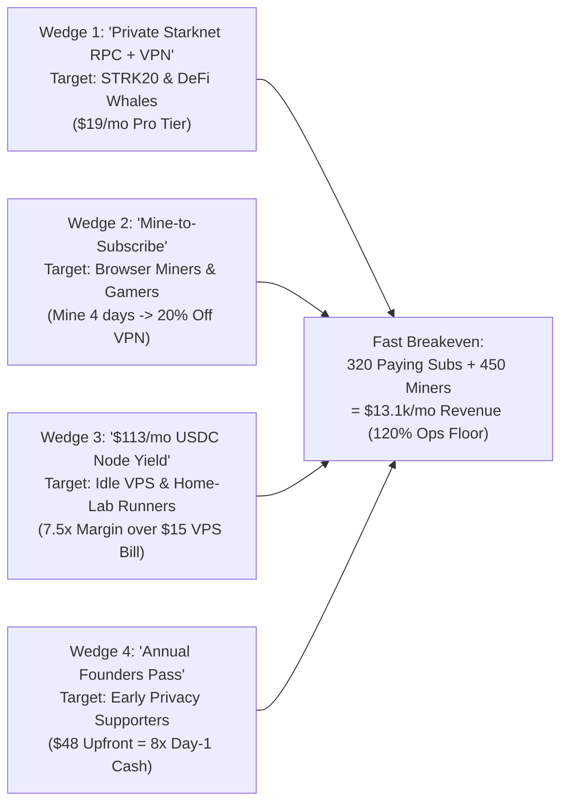

# StarkBlake & BlakeVPN — High-Conversion Go-To-Market (GTM) Strategy v2.1

## 1. Strategic Diagnosis: Why Generic dVPN Launches Fail & How We Win

Most decentralized VPNs (dVPNs) struggle with paid adoption because they try to sell a generic consumer VPN to non-crypto users who already use NordVPN or Mullvad, while emitting high-inflation tokens to thousands of idle residential nodes.

**StarkBlake & BlakeVPN v2.1 flips the playbook with 4 High-Intent GTM Wedges** where users **already have a Starknet wallet**, **already care about IP/metadata privacy**, and **get immediate financial utility from day one**:

---

## 2. The 4 GTM Wedges & Acquisition Playbooks

### Wedge 1: "Private Starknet RPC + dVPN" for STRK20 & DeFi Users (`$19/mo` Pro Tier)
- **The Pain Point:** In 2026, Starknet users are adopting **STRK20 shielded balances and Shadow Accounts** on Ekubo and Vesu. However, if a user submits a transaction from a Shadow Account using the **same home IP address** as their main public wallet, RPC providers (`Alchemy`, `Infura`, sequencers) can trivially link the Shadow Account back to their main wallet via IP metadata!
- **Our Unfair Advantage:** The **BlakeVPN Chrome Extension (`/extension`)** routes both browser traffic AND Starknet wallet RPC calls through bonded BlakeNodes.
- **Channel Execution:**
  - Co-marketing integration with **STRK20 / Shadow Account guides**, **Braavos**, **Argent X**, and **Ekubo LP privacy tutorials** (*"Don't leak your Shadow Account via your IP—turn on BlakeVPN Extension before unshielding"*).
  - Even **65 Pro Trader subscribers** at `$19/mo` generate **`$1,235/mo`**, equivalent to **205 standard `$6/mo` subscribers**.

### Wedge 2: "Mine-to-Subscribe" Viral Funnel (Turning Free Miners into Paying Subscribers)
- **The Pain Point:** Pure airdrop miners farm tokens and dump them.
- **Our Funnel Conversion Mechanic:**
  1. A user opens the **Post-Quantum Browser Miner** (`POSEIDON_PQ`) with zero hardware setup.
  2. After mining **5–8 blocks**, the UI unlocks a 1-click **"Redeem 20% Discount on BlakeVPN ($4.80/mo) or Claim 24h Trial Pass"** badge.
  3. **50% of the `SBLAKE` spent on the pass is burned immediately**, converting miner hashpower into permanent token scarcity and active VPN DAU.
  4. **Referral Multiplier:** Inviting a friend who activates a Paid Pass grants the referrer **+5 daily mint cap for 7 days** (zero unbacked token giveaway).

### Wedge 3: `$113/mo USDC` Node Operator Flywheel (Supply-Side Bootstrap)
- **The Pain Point:** Node operators in legacy DePINs get paid in inflationary native tokens that crash 90%, forcing them to shut down nodes.
- **Our Pitch to VPS Owners (`r/selfhosted`, `r/WireGuard`, Hetzner/Vultr/Netcup communities):**
  - *"Turn a $10/mo idle Ubuntu VPS into a bonded BlakeNode in 60 seconds with 1 bash command (`install-vps.sh`) and earn **`$90–$165/month in USDC/STRK`** from the 30% protocol revenue pool."*
  - To capture that `$113/mo` USDC stream, each operator post-Beta bonds **`10,000 SBLAKE`**, locking **350,000 SBLAKE (at 35 nodes)** to **1,400,000 SBLAKE (at 140 nodes)** off the market!

### Wedge 4: `$48/yr` Annual "Founders Pass" Campaign (8× Upfront Runway Multiplier)
- **The Pain Point:** Monthly `$6` subscriptions build cash reserves slowly (`$3.30` net Ops per user in Month 1).
- **Our Campaign:** Offer the **Plan #2 Annual Pass (`$48/yr` USD or `$38.40` in `SBLAKE`)** during Phase C Launch with a permanent **"Founder Stealth `.blake` Handle"** and priority multi-region routing.
- **Cashflow Impact:** Just **80 Annual Founders Passes** generate **`$3,840` in immediate Day-1 cashflow** (equivalent to **640 monthly `$6` subscribers** in Month 1!).

---

## 3. Revised 4-Phase Gated Rollout & KPI Targets

| Phase | Timeline | Core Deliverables | Hard Gate KPI to Advance |
| :--- | :---: | :--- | :--- |
| **Phase A: Hardened Contracts & PQ Miner** *(Completed ✓)* | Weeks 1–2 | Modular v2.1 Cairo suite (`token`, `miner`, `vesting`, `vpn_payments`, `node_registry`, `timelock`), Post-Quantum `POSEIDON_PQ` miner, auto-provisioning `daemon.mjs`. | `scarb build` & `npm run build` pass; 3-tier plans (`$6` / `$48` / `$19`) & `50%` SBLAKE pass burn active. |
| **Phase B: Seed Alpha & STRK20 IP-Shield Campaign** | Weeks 3–6 | Deploy 20 multi-region nodes (EU/US/APAC); launch Chrome Extension IP-Shield campaign for Starknet STRK20 users; onboard **250 miners + 150 alpha VPN users**. | $\ge 95\%$ node uptime SLA; $\ge 40\%$ 7-day extension retention; **$6,174/mo** run-rate (68% Ops Floor). |
| **Phase C: Fast Breakeven Paid Beta** | Weeks 7–12 | Open **Annual Founders Pass (`$48/yr`)** + **Pro Private RPC Pass (`$19/mo`)** + **Standard (`$6/mo`)**; start weekly USDC payouts to bonded nodes. | **320 paying VPN subs + 450 active miners** $\rightarrow$ **$13,157/mo revenue (120% of `$5,000/mo` Ops Floor Met ✓)**. |
| **Phase D: Mainnet Fair Launch & Net-Deflationary Crossover** | Month 4–12 | Mainnet `SBLAKE` deployment under `Timelock`, Ekubo `SBLAKE/STRK` & `SBLAKE/USDC` pool seeding, automated **15% $\rightarrow$ 41.7% Ekubo TWAP Buyback & Burn**. | Scale from **950 subs (`74%` of emission burned)** to **2,800 subs (`147%` of emission burned — Net Deflationary)**. |

---

## 4. 90-Day Channel & Partnership Calendar

1. **Days 1–15 (Starknet Privacy Narrative):**
   - Publish *"Why Your STRK20 Shadow Account Still Leaks Your Home IP (And How BlakeVPN Fixes It in 1 Click)"* across X, Starknet Discord, and Starknet Community Forum.
   - Submit Starknet Foundation Seed/Growth Grant showcasing **Post-Quantum Poseidon PoW (`SBlakeMiner`)** + **STRK20 IP-layer privacy**.
2. **Days 16–45 (Node Operator Land-Grab):**
   - Release the 60-second video demo of [`node-runner/install-vps.sh`](../node-runner/install-vps.sh) on `r/selfhosted`, `r/homelab`, and LowEndTalk: **20 subsidized Beta slots** with real USDC revenue share starting in Phase C.
3. **Days 46–90 (Annual Founders Pass & Ekubo Flywheel):**
   - Launch the **100 Founders Annual Pass (`$48/yr` or `$38.40` in `SBLAKE`)** + **Pro Trader Private RPC Tier (`$19/mo`)**, crossing the **320-subscriber Fast Breakeven Gate (`$13.1k/mo` gross, `120%` of `$5k/mo` Ops Floor)** ahead of Mainnet Phase D.
