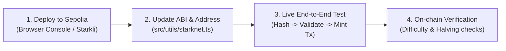

# StarkBlake (SBLAKE) Project Progress & Status Review

**Latest Update:** September 30, 2026  
**Repository:** [github.com/fearmexxx/blake](https://github.com/fearmexxx/blake)  
**Status:** MVP Core Ready → Testnet Deployment & Verification Phase

---

## 📊 Component Status Summary

| Component | Status | Details |
| :--- | :---: | :--- |
| **Frontend UI** | ✅ Complete | Matrix-industrial theme, responsive layout, STRK20 dark pool controls, PWA setup |
| **PoW Mining Engine** | ✅ Complete | Multi-threaded Web Workers with BLAKE2s, dynamic nonce batching |
| **Privacy Note Prover** | ✅ Complete | STRK20 note commitments, scoped viewing keys (`src/utils/privacy.ts`) |
| **Anti-Sybil Fingerprint** | ✅ Complete | Canvas, WebGL renderer, hardware concurrency & display fingerprinting SHA-256 |
| **Cairo Contract** | ✅ Upgraded | Cairo 2.8.0 (`sblake.cairo`) with `ISBlakePrivacy`, daily mint caps, era halving & commitments |
| **Wallet Connector** | ✅ Ready | Modern `@starknet-io/get-starknet` (v4.0+) integration |
| **Build Pipeline** | ✅ Verified | Both Scarb 2.8.1 contract build & Vite production bundle pass cleanly with 0 errors |
| **Contract Deployment** | ⏳ Ready | Pre-built artifacts ready for Sepolia deployment |

---

## ✅ Completed Milestones
- [x] **STRK20 Shielded Mining Implementation**: Privacy note commitments and `mint_shielded` function in Cairo with +15% emission yield boost.
- [x] **Economic Flywheel Integration**: Burn sink structure (0.25% fee), shielded staking pool UI telemetry, and Brother ID 2x daily cap.
- [x] **Browser Mining Engine**: Parallel Web Worker implementation utilizing BLAKE2s with CPU core scalability.
- [x] **Client Dashboard UI**: Hashrate telemetry (KH/s), session metrics, viewing key indicator, and thread control.
- [x] **Anti-Sybil Device Identity**: Client-side hardware/rendering fingerprinting for wallet-hardware binding.
- [x] **Cairo Smart Contract**: Storage structures, `get_challenge`, `mint`, `mint_shielded`, and `shield` compiled cleanly with Scarb.
- [x] **Browser Deployment Workaround**: Injected wallet script (`scripts/browser_deploy.js`) for browser console deployment via Starkscan/Voyager.

---

## ⏳ Critical Path & Immediate Priorities

1. **Deploy Contract to Sepolia**:
   - Execute deployment via `scripts/browser_deploy.js` on [Starkscan Sepolia](https://sepolia.starkscan.co/) with Argent X / Braavos, or via `starkli`.
2. **Wire Frontend to Deployed Contract**:
   - Replace placeholder in `src/utils/starknet.ts` with real `CONTRACT_ADDRESS`.
   - Switch mock challenge fetching to live contract call `contract.get_challenge(address)`.
   - Wire `mintSBlake` to execute real `account.execute(...)` transaction with nonce.
3. **End-to-End Mining Verification**:
   - Run mining loop in browser, produce valid nonce matching target difficulty.
   - Submit transaction, verify on Starkscan that tokens are minted to caller balance.
4. **On-Chain BLAKE2s Proof Verification (Phase 1.1)**:
   - Transition contract from open testing minting to on-chain `blake2s` validation once testnet flow is validated.

