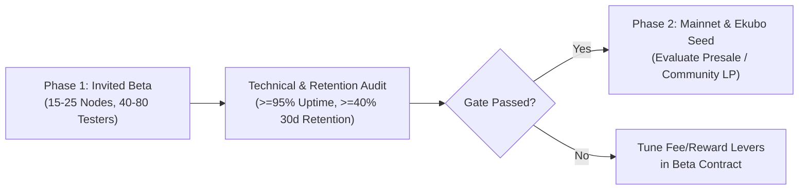

# StarkBlake (`SBLAKE`) — BlakeVPN & BlakeNode Status Summary (Draft 1.1)

**Latest Update:** October 18, 2026  
**Repository:** [github.com/fearmexxx/blake](https://github.com/fearmexxx/blake)  
**Specification Baseline:** *BlakeVPN & BlakeNode: Privacy-First Economic & Operational Documentation (Draft 1.1, October 2026)*  
**Current Execution Stage:** **Phase 1 — Invited Beta & Technical Validation** *(Public Presale Deferred)*

---

## 1. Executive Summary & Strategic Direction

Following our economic flywheel audit and alignment with **Draft 1.1 (October 2026)**, StarkBlake (`SBLAKE`) has transitioned from an early high-emission prototype (`100 SBLAKE/mint`, `100k` interval) to a disciplined, revenue-backed **Privacy-First DePIN & VPN Ecosystem** on Starknet (`10 SBLAKE/mint` Era 1, `900k` interval, `$5,000/mo` Operations Cost Floor, and `60/25/15` protocol revenue routing).

### Beta-First Policy (No Premature Presale)
Rather than launching a speculative token presale before validating product-market fit, we have **deferred any presale decision** until the conclusion of our **3–4 Month Invited Beta Phase**. All premature `"GENESIS SALE ($0.02 BUY NOW)"` UI prompts have been replaced with the interactive **BlakeVPN & BlakeNode Invited Beta Console**.

---

## 2. Component & Architecture Status Matrix

| Component | Status | Draft 1.1 Implementation Details |
| :--- | :---: | :--- |
| **Cairo Smart Contract (`contracts/src/sblake.cairo`)** | ✅ Compiled | Era 1 = `10 SBLAKE` (`5` → `2.5` → `1.25` → `0.625` → `0.3125`), `900,000` mint halving interval, `21M` cap, 7-day STRK20 maturity (`604,800s`), `bond_blake_node`, `purchase_vpn_pass`, `burn_for_utility`, `replace_class_syscall` upgradeability |
| **Starknet v0.10 & Xverse Relayer (`src/utils/relayer.ts`)** | ✅ Fixed | Upgraded `starknet` SDK to `v8.9.2` with native V3 `l1_data_gas` resource bounds for Alchemy `v0_10`; 1-click UDC deployment for Xverse, Argent X, and Braavos |
| **Economic Flywheel Simulator (`src/components/EconomicSimulator.tsx`)** | ✅ Upgraded | Models the 3 Draft 1.1 Scenarios (*Invited Beta Min*, *Post-Beta Target*, *Growth Scale*), `$5,000/mo` Ops Cost Floor, `60/25/15` revenue split, `0.5–1.0 STRK` mint fee (with 50% 7-day lock discount), and Year-1 Free Float ($\le 40\text{–}45\%$) |
| **Miner & Era Schedule (`src/components/Miner.tsx`)** | ✅ Upgraded | Multi-threaded BLAKE2s Web Worker, STRK20 `+15%` shielded emission bonus (`11.5 SBLAKE`), 7-day maturity fee discount indicator, `900,000` mint progress tracker |
| **BlakeVPN & BlakeNode Beta Console (`src/App.tsx`)** | ✅ Complete | Live test actions for Unlinkable STRK20 VPN Pass billing (`250 SBLAKE` / `$5/mo` Beta rate) and Invited Beta BlakeNode bonding (`10,000 SBLAKE` or Beta-subsidized) |

---

## 3. Compiled On-Chain Artifacts (Starknet Sepolia)

- **Contract Source:** [`contracts/src/sblake.cairo`](file:///e:/2026/starkmine/contracts/src/sblake.cairo)
- **Sierra Artifact:** [`contracts/target/dev/sblake_sblake.contract_class.json`](file:///e:/2026/starkmine/contracts/target/dev/sblake_sblake.contract_class.json)
  - **Sierra Class Hash:** `0x1287c5cce2f2c41d3806c196ed87c58e0968e0cf0fd482b872621b54778e391`
- **CASM Artifact:** [`contracts/target/dev/sblake_sblake.compiled_contract_class.json`](file:///e:/2026/starkmine/contracts/target/dev/sblake_sblake.compiled_contract_class.json)
  - **CASM Class Hash:** `0x71a32f7e84351096cba593526d2be781d995b2d0406e0d29aecc2dbea234b94`
- **Sepolia Automated Relayer Account:** `0x35260a1162058d98cda528a7e7484195fda550acc5db70a840e0b89339a1f07` (Deployed on-chain, funded with Sepolia STRK, compatible with Starknet RPC `v0_10` V3 `l1_data_gas` bounds)

---

## 4. Draft 1.1 Economic Flywheel Specification

### 4.1 Token Supply & Halving Schedule
- **Ticker:** `SBLAKE` | **Max Supply:** `21,000,000 SBLAKE` (Hard Capped)
- **Halving Cadence:** Every `900,000` mints (`800k–1,000k` configurable governance range; `~10–14 months` at `400–600` active miners):
  - **Era 1 (`0 – 900k` mints):** `10 SBLAKE` base (`11.5 SBLAKE` shielded) → `~9,000,000 SBLAKE`
  - **Era 2 (`900k – 1.8M` mints):** `5 SBLAKE` base (`5.75 SBLAKE` shielded) → `~4,500,000 SBLAKE`
  - **Era 3 (`1.8M – 2.7M` mints):** `2.5 SBLAKE` base → `~2,250,000 SBLAKE`
  - **Era 4 (`2.7M – 3.6M` mints):** `1.25 SBLAKE` base → `~1,125,000 SBLAKE`
  - **Era 5 (`3.6M – 4.5M` mints):** `0.625 SBLAKE` base
  - **Era 6+ (`4.5M+` mints):** `0.3125 SBLAKE` tail emission until `21,000,000` cap
- **Year-1 Free Float Target:** Keep liquid circulating float $\le 40\text{–}45\%$ of emitted supply via:
  1. **STRK20 Dark Pool Lockups ($\ge 7$ Days):** Miners keeping rewards shielded for $\ge 7$ days (`604,800` seconds) receive a `+15%` mint bonus and a **50% discount** on the protocol mint fee.
  2. **BlakeNode Collateral Bonds:** `10,000 SBLAKE` staked per active exit/relay node (`50 nodes = 500,000 SBLAKE` locked; `120 nodes = 1,200,000 SBLAKE` locked).
  3. **Deflationary Buyback & Utility Burns:** `25%` of protocol revenue + `0.25%` unshield fee + `50–500 SBLAKE` Overclock / `.blake` Stealth ID burns.

### 4.2 Protocol Revenue Streams & Allocation Split
1. **Protocol Mint Fee:** `0.5–1.0 STRK` per mint (`50%` discount for $\ge 7$-day STRK20 locks).
2. **BlakeVPN Subscriptions:** `$5/mo` (Invited Beta minimum) to `$8–$10/mo` (Post-Beta target), payable in `SBLAKE` (including unlinkable STRK20 notes) or `STRK`/`USDC` auto-swapped via Ekubo.
3. **STRK20 Privacy Action Fee:** Flat `$0.10–$0.15` (`~$0.12` default) per shield, unshield, or private note transfer.

| Revenue Bucket | Year-1 Default Share | Purpose & Taper Governance Rule |
| :--- | :---: | :--- |
| **Operations Treasury** | **60%** *(50–70% range)* | Covers the **`$5,000/mo` Ops Cost Floor**: `$3k–$4k` for 15–20 core EU/US/Asia exit nodes, `$1k–$1.5k` lean community growth, `$500–$1k` RPC/security contingency. **Tapers down** once the `$5,000/mo` floor is met for 3 consecutive months. |
| **Buyback & Burn** | **25%** *(20–30% range)* | Automated Ekubo TWAP market buyback and permanent on-chain supply burn (`total_burned`). Scales upward as Operations share tapers. |
| **Shielded Pool & Node Yield** | **15%** *(10–20% range)* | Real-yield rewards distributed to $\ge 7$-day STRK20 note holders and verified BlakeNode operators passing uptime/latency SLA checks. |

---

## 5. Invited Beta Roadmap & Gate Criteria (3–4 Months)

1. **Cohort 1 — Invited BlakeNode Operators (`15–25` Nodes):**
   - Multi-region WireGuard/SOCKS5 exit & residential relay nodes across EU, US, and Asia.
   - **Validation Target:** $\ge 95\%$ uptime, $\le \$200/\text{mo}$ bandwidth cost per node, automated heartbeat & collateral slashing verification.
2. **Cohort 2 — Invited BlakeVPN Client Testers (`40–80` Users):**
   - End-to-end testing of unlinkable VPN session authentication using STRK20 nullifiers (`purchase_vpn_pass`).
   - **Validation Target:** $\ge 40\%$ 30-day active retention and $\ge 30\%$ verified willingness to pay `$5–$10/mo` post-Beta.
3. **Post-Beta Decision Gate (Presale vs. Direct Fair Launch):**
   - Only after the 3–4 month Beta metrics confirm sustainable unit economics will governance decide whether to conduct a capped liquidity seed round or proceed directly with protocol-owned liquidity on Ekubo.
